# LickMyPaw

[](https://github.com/tcsenpai/LickMyPaw/actions/workflows/build.yml)
[](LICENSE)

**The free, open source alternative to CleanMyMac.**

Website: [tcsenpai.github.io/LickMyPaw](https://tcsenpai.github.io/LickMyPaw/)

LickMyPaw cleans up your Mac: it shows what eats your disk, clears caches and junk, uninstalls apps with their leftovers, finds large and duplicate files, and checks your system for problems. It is a native app written in Swift and SwiftUI. No subscription, no account, no telemetry, and you can read every line of it.

<p align="center">
  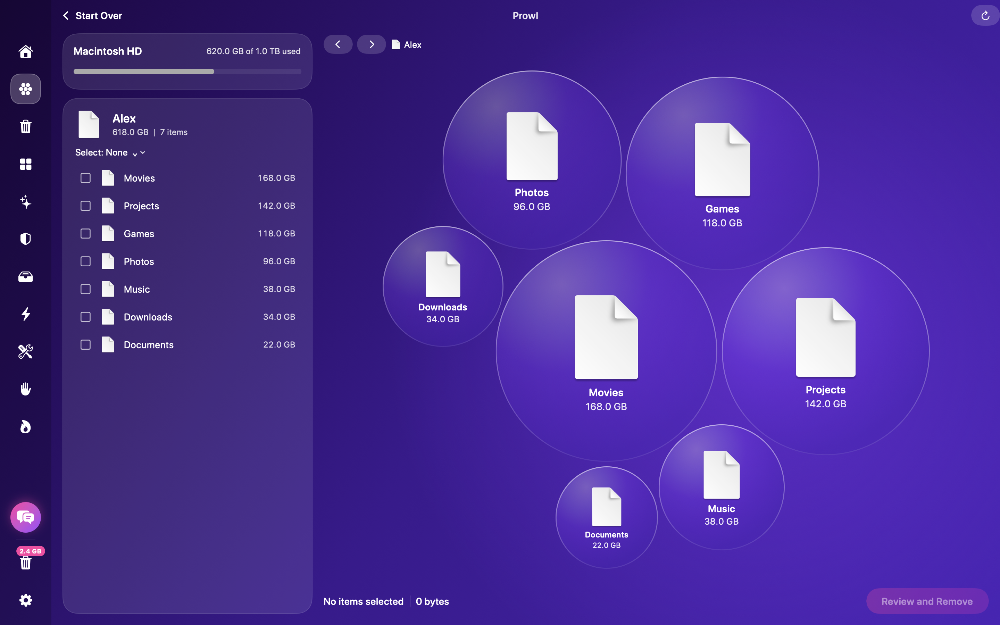
</p>

## Why

Mac cleaners are useful, but the good ones are paid, closed, and ask for deep access to your files. LickMyPaw gives you the same kind of tools in a form you can audit:

- **Free and MIT licensed.** Use it, fork it, change it.
- **Nothing is deleted for good.** Everything LickMyPaw removes goes to the Trash first, and every action is logged so you can undo it.
- **One safety gate.** Every delete goes through the same check, which refuses system locations and any folder you excluded.
- **No telemetry.** The app sends no identifiers. It makes network calls in three cases and no others: the update check (it asks GitHub for the latest release once a day, and you can turn that off in Settings), the ClamAV signature download, only if you install ClamAV from the app, and the update checks in Applications, only when you press Check for updates.
- **Scriptable.** The same binary has a JSON command line, so scripts and AI agents can use it too.

## Screenshots

<table>
  <tr>
    <td>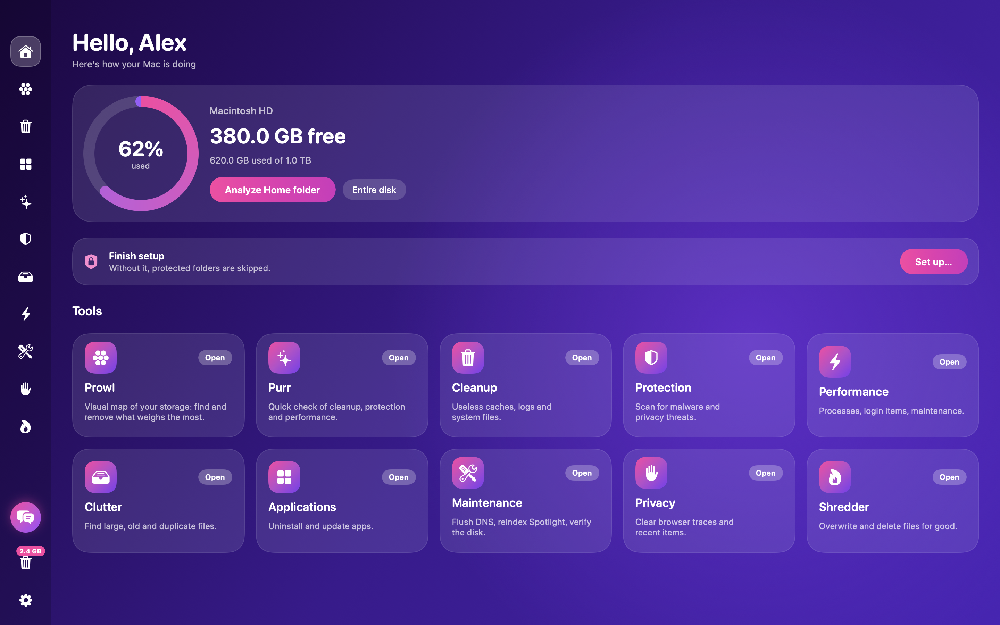</td>
    <td>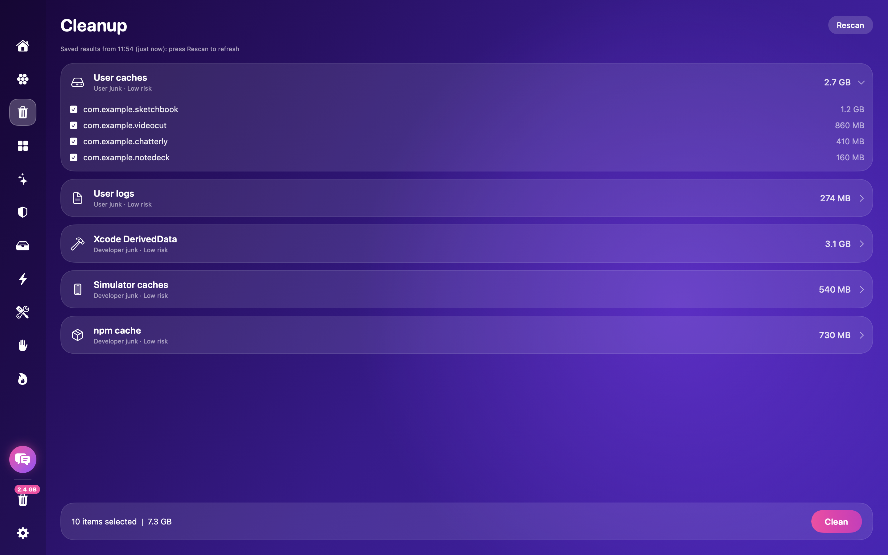</td>
  </tr>
  <tr>
    <td>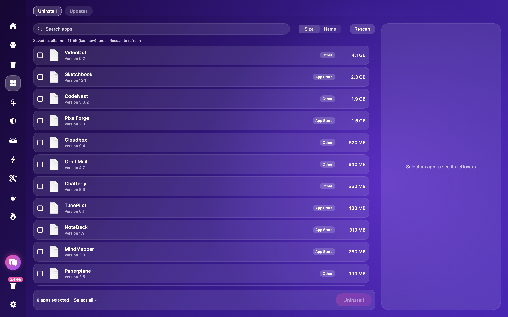</td>
    <td>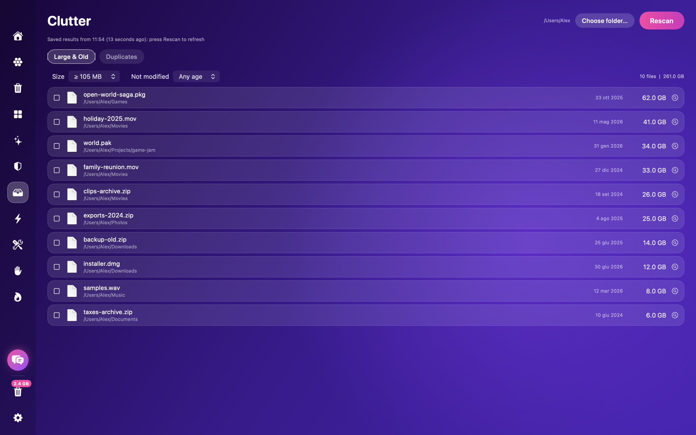</td>
  </tr>
  <tr>
    <td>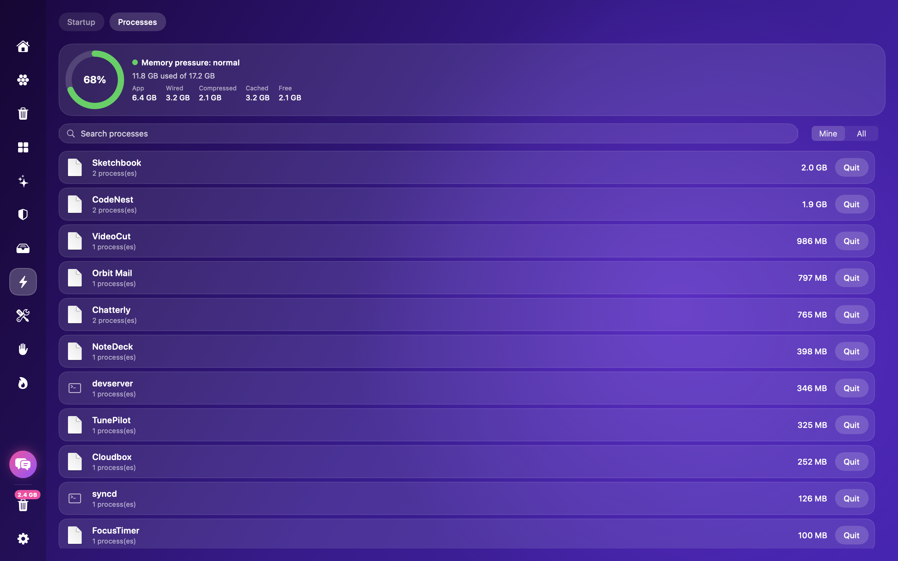</td>
    <td>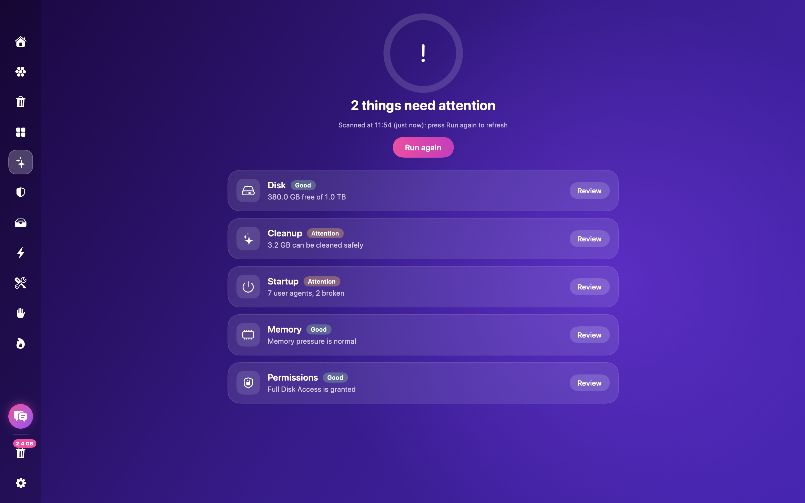</td>
  </tr>
  <tr>
    <td>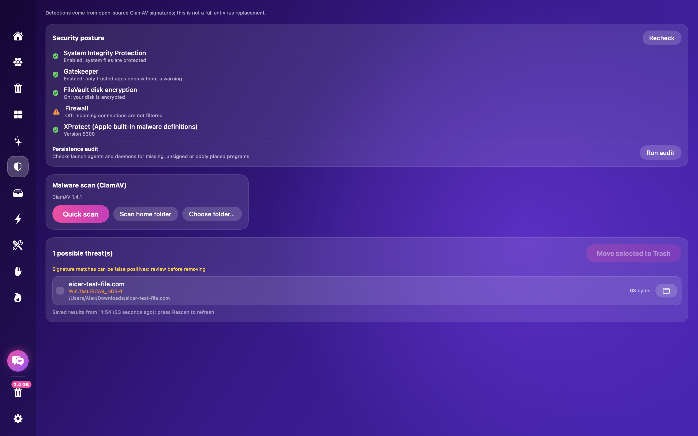</td>
    <td>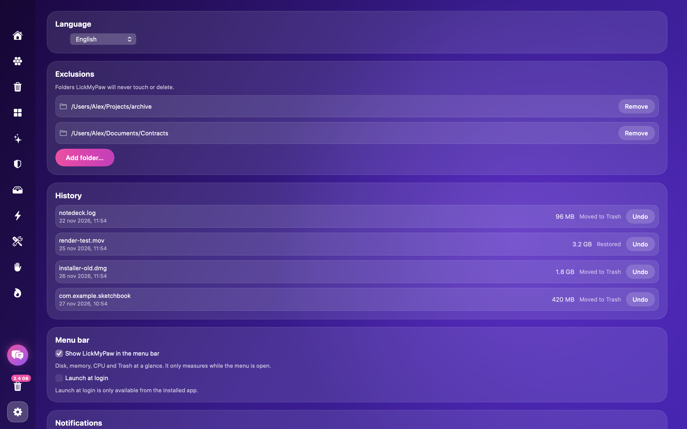</td>
  </tr>
  <tr>
    <td>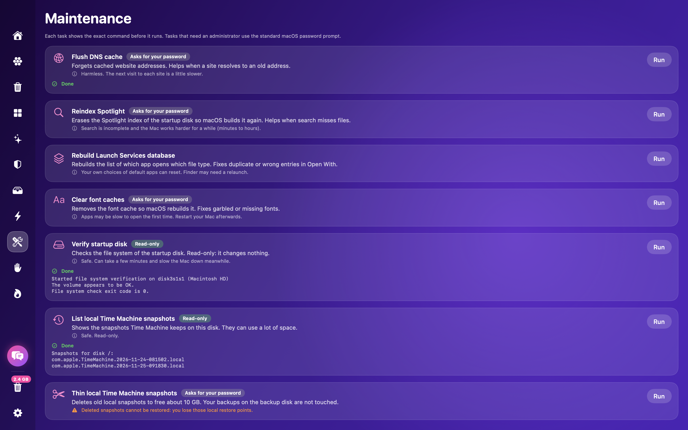</td>
    <td>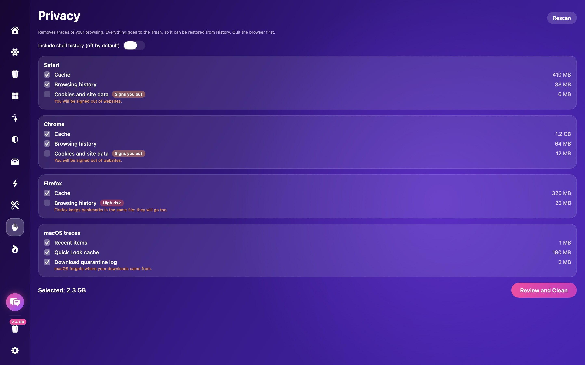</td>
  </tr>
  <tr>
    <td>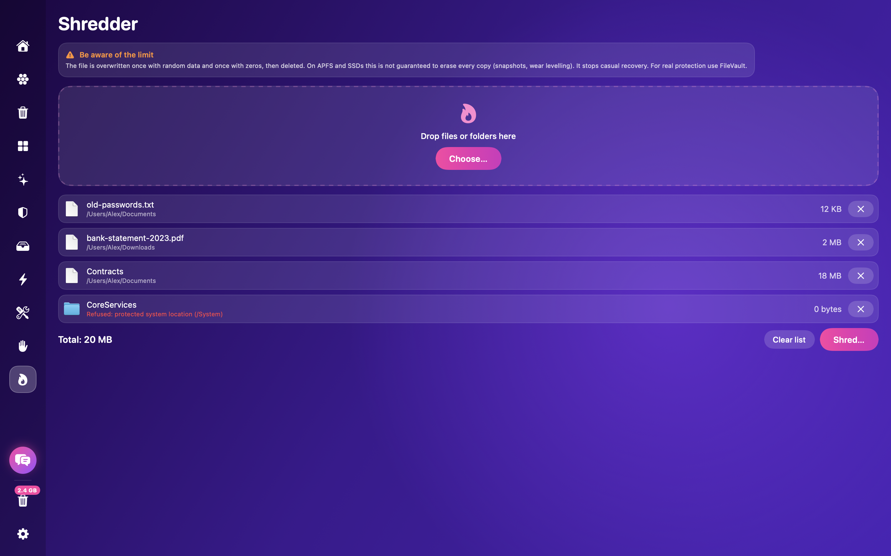</td>
    <td>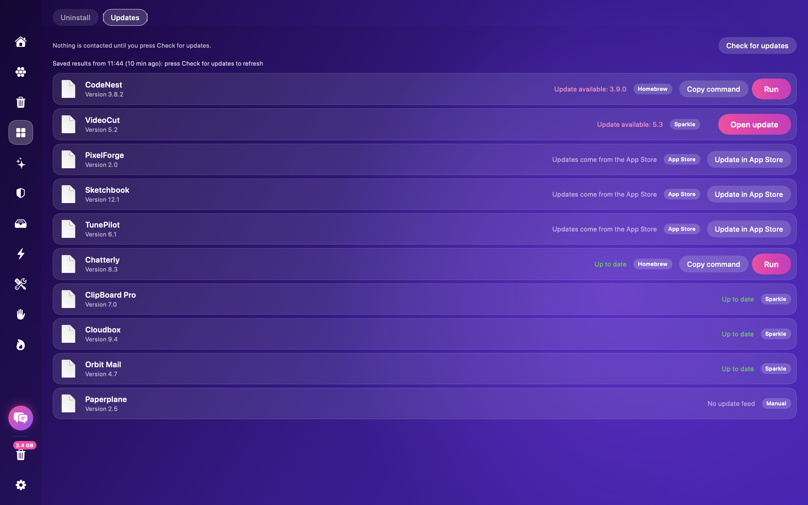</td>
  </tr>
  <tr>
    <td>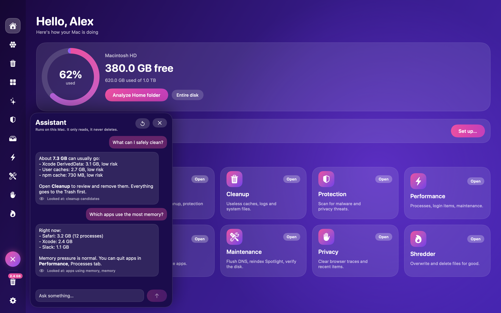</td>
    <td></td>
  </tr>
</table>

<p align="center">
  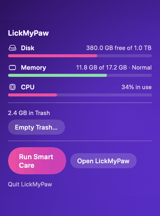
</p>

The screenshots use made-up demo data.

## Download

Get the latest build from the [Releases](https://github.com/tcsenpai/LickMyPaw/releases) page. Every commit also uploads its build as an artifact in [Actions](https://github.com/tcsenpai/LickMyPaw/actions).

- `LickMyPaw-<version>-macos-arm64.dmg`: open it and drag the app to Applications
- `LickMyPaw-<version>-macos-arm64.zip`: the zipped `LickMyPaw.app`
- `SHA256SUMS.txt`: checksums for both files

> [!WARNING]
> **These builds are not signed with an Apple Developer ID and are not notarized.** They are only ad-hoc signed, which Apple Silicon needs to run them at all. macOS Gatekeeper will warn you the first time you open the app. By running it you are trusting this repository and the CI that built it. If you would rather not, build it yourself (see below) and compare. Builds are for Apple Silicon (arm64) and macOS 13 or later.

To open an unsigned app, right-click `LickMyPaw.app`, choose **Open**, then **Open** again. Or remove the quarantine flag once:

```bash
xattr -dr com.apple.quarantine /Applications/LickMyPaw.app
```

## What you get

| Section | What it does |
|---|---|
| **Home** | Disk usage at a glance and a shortcut to every tool. |
| **Prowl** | A bubble map of your disk. Scan a folder or the whole disk, drill down, select items and move them to the Trash. Hard links are counted once. |
| **Cleanup** | User caches, logs, crash reports, saved state and developer caches (Xcode DerivedData, npm, bun, cargo, gradle, pip, uv, Homebrew), Mail downloads, iOS device backups, Simulator devices, Xcode iOS DeviceSupport and Archives. Risky categories (backups, archives, simulators, Mail downloads) start unchecked. Caches of running apps are skipped, and so are Mail downloads while Mail is open and Simulator devices while Simulator is open. |
| **Applications** | Lists your apps and finds the files they leave behind. You can select several apps and uninstall them in one go. The Updates tab checks Sparkle feeds, shows which apps update through the App Store, and reads `brew outdated --cask` when Homebrew is installed. It only contacts anything when you press Check for updates, and Homebrew upgrades run only after you confirm. |
| **Clutter** | Large and old files, and duplicates (size, then a partial hash, then SHA-256). One copy of each duplicate group is always kept. |
| **Performance** | Startup items with a reversible on/off switch, and processes and memory grouped by app, with a polite quit. |
| **Purr** | A one-click checkup that reuses the other tools and tells you what needs attention. |
| **Protection** | Malware scan with the open source [ClamAV](https://www.clamav.net/) engine, plus checks for SIP, Gatekeeper, FileVault, the firewall and XProtect, and an audit of what starts at login. |
| **Maintenance** | Flush the DNS cache, reindex Spotlight, rebuild the Launch Services database, clear font caches, verify the startup disk (read-only), and list or thin local Time Machine snapshots. Every task shows its exact command first. Admin tasks use the standard macOS password prompt. |
| **Privacy** | Finds Safari, Chrome, Edge, Brave, Arc and Firefox caches, history, cookies and download lists, plus Recent Items, the Quick Look cache and the download quarantine log. Shell history is opt-in. The browser must be quit first, everything goes to the Trash, and cookies are unchecked by default. Safari needs Full Disk Access. |
| **Shredder** | Overwrites files with random data and then zeros before deleting them. It cannot be undone. See the limit below. |
| **Assistant** | A chat bubble at the bottom of the sidebar (macOS 26 or later with Apple Intelligence). Ask what takes up space, what can be cleaned, which apps you no longer use, what starts at login or which apps use the most memory. It runs on Apple's on-device model, reads only sizes, names and dates through eight fixed read-only tools, never file contents, and cannot delete anything: it tells you which page does. It answers in the language you ask in. Without Apple Intelligence it explains why and links to the right System Settings pane. |
| **Trash button** | Always in the sidebar. Shows the Trash size, opens it, and empties it after asking. |
| **Menu bar** | A paw icon with free disk, memory pressure, CPU load and the Trash (with Empty Trash), plus shortcuts to Smart Care and the app. It only measures while the menu is open. Can be hidden in Settings. |
| **Settings** | Language, menu bar and launch at login, optional notifications (disk almost full, big Trash), updates, excluded folders, and a history of actions with Undo. |

Available in English, Italian, French and Spanish. It follows your macOS language.

## How it compares to CleanMyMac

LickMyPaw covers the everyday jobs. It is a young project, so here is what it does not have yet:

| | CleanMyMac | LickMyPaw |
|---|---|---|
| Price | Subscription or paid license | Free |
| Source code | Closed | Open, MIT |
| Disk map, cleanup, uninstaller, duplicates, startup items | Yes | Yes |
| Malware scan | Own engine | ClamAV (open source, optional install) |
| Privacy cleaner, maintenance tasks, file shredder | Yes | Yes |
| Real-time malware monitor | Yes | No |
| Signed and notarized builds | Yes | Not yet |
| Menu bar app | Yes | Yes |
| Automatic updates | Yes | Yes, through a GitHub release check, checksum verified. The builds are unsigned (Sparkle comes with signing) |
| Updater for your other apps | Yes | Yes, on demand (Sparkle, App Store, Homebrew casks) |
| Command line for scripts | No | Yes, JSON output |
| Telemetry | Depends on settings | None |

The malware scan relies on ClamAV signatures. It is useful for checking files you downloaded, but it is not a replacement for a full antivirus.

CleanMyMac is a trademark of MacPaw. LickMyPaw is an independent project and is not affiliated with or endorsed by MacPaw.

## Menu bar, notifications and updates

- **Cost:** the menu bar icon is static. Stats are sampled only while its menu is open (every 2 seconds). In the background there is one check at most every 5 minutes that reads the free disk space and nothing else: no scans, no process lists. If notifications and the daily update check are both off, there is no timer at all.
- **Notifications** are off until you enable them in Settings (macOS then asks for permission). They cover a nearly full disk (default: below 10 percent or 10 GB free) and a large Trash (default: over 5 GB), at most one of each per day.
- **Launch at login** is an explicit toggle, off by default. It shows the real state, including when macOS wants your approval.
- **Updates:** LickMyPaw asks `api.github.com` for the latest release (generic `LickMyPaw` user agent, nothing identifying) once a day, or when you press Check for updates. It ignores pre-releases, downloads the zip, checks it against the release's `SHA256SUMS.txt` (a mismatch is refused), checks the bundle identifier, then replaces itself and relaunches. If it cannot write to its folder it shows the new app in Finder instead.

## Build from source

You need macOS 13 or later and a Swift 5.9+ toolchain (Xcode or the Command Line Tools). There is no Xcode project.

```bash
./bundle.sh                      # builds LickMyPaw.app, ad-hoc signed
open LickMyPaw.app               # or: open LickMyPaw.app --args --page cleanup
VERSION=0.2.0 ./package.sh       # also writes dist/*.dmg, dist/*.zip and SHA256SUMS.txt
```

To scan the whole disk, give the app **Full Disk Access** in System Settings, Privacy & Security. The app has a short guide for it. Emptying the Trash from the app goes through Finder, so macOS asks for the Automation permission once.

## Command line

The app binary also works as a command line tool. Output is JSON.

```bash
BIN=LickMyPaw.app/Contents/MacOS/LickMyPaw
$BIN scan ~ --depth 2 --top 15 --min 100M     # size tree, biggest first
$BIN big ~/Library --files --limit 30         # the largest files
$BIN trash ~/Downloads/old.dmg                # dry run, add --yes to move it to the Trash
$BIN update --check                           # current vs latest release (asks GitHub)
```

There is a ready-made skill for AI coding agents in [`skill/SKILL.md`](skill/SKILL.md). Link it to `~/.claude/skills/lickmypaw` to use it with Claude Code.

## Tests and CI

```bash
.build/release/LickMyPaw --selftest              # all suites
.build/release/LickMyPaw --selftest cleanup      # one suite
```

The suites run on throwaway folders and a fake home. They never touch your files and never run the real `launchctl` or `brew`. [`.github/workflows/build.yml`](.github/workflows/build.yml) runs them on an Apple Silicon runner, then builds the DMG and the zipped app. Pushing a tag such as `v0.2.0` publishes a GitHub Release with both files.

## Roadmap

Still missing: letting the assistant propose a cleanup that opens the usual Review sheet (today it only points you to the right page); Developer ID signing and notarization, with Sparkle based updates, planned for 1.0.0 (until then the built-in updater checks GitHub Releases and verifies the SHA-256); and a real-time malware monitor, which needs the Endpoint Security entitlement from Apple.

Known limits: the Shredder overwrites a file once with random data and once with zeros, but on APFS (copy-on-write, snapshots) and on SSDs (wear levelling) that does not guarantee every copy of the data is gone. It stops casual recovery; for real protection use FileVault. Builds are Apple Silicon only, hard links and APFS clones are counted approximately, and undoing a removal does not put files back into lists you already scanned until you rescan.

## Translations

Interface strings use the English text as the key. Add or fix a translation in `Sources/LickMyPaw/Resources/<lang>.lproj/*.strings`, one table per section. To try a language without changing macOS:

```bash
LICKMYPAW_LANG=fr LickMyPaw.app/Contents/MacOS/LickMyPaw
```

## Contributing

Issues and pull requests are welcome. Keep changes small and add a `--selftest` check for new logic. Anything that deletes must go through `Engine.trash`, which applies the safety check.

## Credits

The app icon is based on "Black Cat Paw" by lesnivila (CC0, via [Openclipart](https://openclipart.org/detail/28992/black-cat-paw)). Details are in [`assets/icon-source/ATTRIBUTION.md`](assets/icon-source/ATTRIBUTION.md). Malware scanning uses [ClamAV](https://www.clamav.net/) (GPLv2) as an external program. It is not bundled or linked.

## License

MIT. See [LICENSE](LICENSE).
